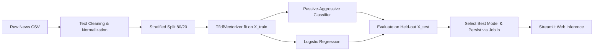

# Fake News Detection System Using Python and Machine Learning

An interactive, Python-centric machine learning application engineered for third-year **B.Sc. Artificial Intelligence and Machine Learning** students to demonstrate data analysis, feature engineering, text classification, model evaluation, and web deployment.

---

## 📌 1. Project Overview

The **Fake News Detection System** accepts news headlines and article text and predicts whether the content resembles examples labeled as **"Potentially Fake"** or **"Likely Reliable"** based on patterns learned from a labeled training dataset.

### Key Objectives:
- **Zero Frontend Fragmentation:** 100% Python-centric architecture using **Streamlit** (no JavaScript/HTML/React needed).
- **Dual Model Comparative Architecture:** Implements and compares both **Passive-Aggressive Classifier** (large-margin online classifier) and **Logistic Regression** (probabilistic baseline).
- **Explainable AI (XAI):** Features an interpretability engine that identifies the specific keywords/n-grams that drove the model's classification.
- **Responsible AI Disclaimer:** Prominently clarifies that the model evaluates stylistic and lexical patterns in text rather than asserting omniscient factual truth.
- **Academic Rigor:** Built specifically for college presentations, project submissions, and viva voce defense.

---

## 🛠️ 2. Technology Stack

| Layer | Technology | Purpose |
|:---|:---|:---|
| **Core Language** | Python 3.10+ | Primary programming language |
| **Interactive Dashboard** | Streamlit | Modern dark navy & blue dashboard UI |
| **Data Manipulation** | Pandas & NumPy | Dataset ingestion, deduplication, cleaning, array math |
| **Machine Learning** | Scikit-learn | TF-IDF vectorization, Logistic Regression, Passive-Aggressive |
| **Feature Extraction** | `TfidfVectorizer` | Sublinear TF-IDF with unigrams & bigrams (max 5,000 features) |
| **Data Visualization** | Matplotlib & Seaborn | Class balance, word-length histograms, confusion matrix heatmaps |
| **Model Persistence** | Joblib | Serialization of pipelines, fitted models, and test metrics |
| **Data Storage** | CSV | Dataset storage and user analysis history tracking |

---

## 📂 3. Project Directory Structure

```
Fake-News-Detection-System/
├── app.py                      # Multi-page Streamlit application (6 interactive pages)
├── train_model.py              # ML training pipeline (data cleaning, TF-IDF, training, evaluation, saving)
├── data_analysis.py            # Pandas analysis functions, summary statistics, chart generators
├── predict.py                  # Real-time inference engine, confidence scoring, keyword explainability
├── utils.py                    # Text preprocessing, normalization, and label encoding helpers
├── history_manager.py          # Persistent query history logger (CSV storage, retrieve, clear)
├── test_system.py              # Automated unit and integration test suite
├── requirements.txt            # Python dependencies specification
├── README.md                   # Complete academic documentation and viva cheat sheet
├── .streamlit/
│   └── config.toml             # Streamlit theme (Dark navy, blue, white) & headless settings
├── dataset/
│   ├── news_dataset.csv        # Curated, balanced starter dataset (Reliable vs Fake news across domains)
│   ├── create_dataset.py       # Script to build or regenerate starter dataset
│   └── README.md               # Dataset documentation, column schema, benchmark sources (WELFake/ISOT)
├── models/
│   ├── news_model.joblib       # Best trained classification model
│   ├── tfidf_vectorizer.joblib # Fitted TF-IDF vectorizer
│   ├── news_pipeline.joblib    # Unified Scikit-Learn inference pipeline
│   ├── logistic_regression.joblib # Trained Logistic Regression model
│   ├── passive_aggressive.joblib  # Trained Passive-Aggressive model
│   └── model_metrics.joblib    # Actual test set evaluation metrics, confusion matrix, comparison data
└── history/
    └── analysis_history.csv    # Query history with timestamp, text preview, prediction, confidence
```

---


---

## 🧠 5. Machine Learning Pipeline Explained



### 1. Data Ingestion & Preprocessing (`utils.py`)
- **Missing Value Handling:** Replaces NaN values in headlines or bodies with empty strings.
- **Deduplication:** Drops duplicate articles before splitting to guarantee no identical texts appear in both training and test sets.
- **Regex Cleaning:** Lowercases text, strips HTML tags (`<.*?>`), removes hyperlinks (`https?://\S+`), and filters non-alphanumeric noise while preserving whitespace.

### 2. Feature Extraction: TF-IDF Vectorization
Text cannot be directly consumed by mathematical algorithms. We transform text into numerical vectors using **TF-IDF**:
$$\text{TF-IDF}(t, d, D) = \text{TF}(t, d) \times \text{IDF}(t, D)$$
- **Term Frequency (TF):** Measures how frequently token $t$ appears in document $d$.
- **Inverse Document Frequency (IDF):** Penalizes ubiquitous words (e.g. "said", "today") and rewards words unique to specific genres.
- We configure:
  - `ngram_range=(1, 2)`: Captures single words and two-word phrases (e.g., *"secret leak"*, *"peer-reviewed"*).
  - `max_features=5000`: Caps vocabulary size to the 5,000 most informative features.
  - `stop_words='english'`: Filters out common grammatical filler words.

### 3. Model Training & Comparison
We train two complementary linear classification models:
1. **Passive-Aggressive Classifier:**
   - Online learning algorithm.
   - If a training sample is classified correctly with sufficient margin, parameters remain unchanged (**passive**).
   - If misclassified, parameters aggressively update to minimize hinge loss (**aggressive**).
   - Well-suited for high-dimensional, sparse text matrices.
2. **Logistic Regression:**
   - Probabilistic baseline utilizing the sigmoid link function:
     $$P(y=1|x) = \frac{1}{1 + e^{-(\mathbf{w}^T \mathbf{x} + b)}}$$
   - Provides smooth, calibrated posterior class probabilities.

### 4. Zero Data Leakage Guarantee
A critical academic point for viva presentations:
> **The vectorizer is fit strictly on `X_train` (`fit_transform`) and only used to transform `X_test` (`transform`).**  
> We never fit the vectorizer on the full dataset before splitting, which would allow vocabulary frequencies from the test set to bleed into training.

---

## 🖥️ 6. Streamlit Web Dashboard Walkthrough

The application features 6 dedicated pages accessible via the sidebar:

1. **🏠 Home Dashboard:**
   - Displays real-time metrics loaded from `model_metrics.joblib`: Total records, Train/Test split sizes, Test Accuracy, and Test F1-Score.
   - Visual step-by-step roadmap explaining the data science lifecycle.
   - Quick CTA button navigating to the detection page.
2. **🔍 Detect Fake News:**
   - Interactive inputs for headline and full article text.
   - **4 Quick Demonstration Samples** allowing 1-click loading of authentic vs fabricated news.
   - Real-time prediction with status cards (`⚠️ Potentially Fake` vs `✅ Likely Reliable`).
   - Confidence percentage meter and diagnostic explanations.
   - **Explainability Pill Badges:** Highlights specific n-grams from the article that pushed the prediction toward Fake or Reliable.
   - Prominent **Responsible AI Disclaimer**.
3. **📊 Dataset Explorer:**
   - Interactive Pandas DataFrame preview (`df.head()`).
   - Schema audit: column types, non-null counts, duplicate row audit.
   - Visualizations: Class balance bar chart and article word count KDE distributions.
   - Most frequent n-grams in Reliable vs Fake classes.
   - Interactive keyword search and class filter.
4. **📈 Model Performance:**
   - Held-out test set metrics: Accuracy, Precision, Recall, and F1-Score.
   - Side-by-side comparison chart: Logistic Regression vs Passive-Aggressive Classifier.
   - Annotated Confusion Matrix heatmap (True Negatives, False Positives, False Negatives, True Positives).
   - Scikit-learn Classification Report table.
   - Dedicated Viva Voce Guide breaking down metric formulas and real-world implications.
5. **🕒 Analysis History:**
   - Automatically logs user predictions to `history/analysis_history.csv`.
   - Displays timestamp, headline, article snippet, prediction, confidence, and word count.
   - Includes summary analytics and a "Clear History" button.
6. **ℹ️ About the Project:**
   - Complete academic documentation, theoretical explanations, ethical limitations, and 12+ viva exam questions and answers.

---

## 🎬 7. Project Demonstration Guide (For Evaluators)

When demonstrating this project to a teacher, examiner, or class:

1. **Start on the Home Dashboard:**
   - Explain the motivation: combating online misinformation using machine learning.
   - Point to the metrics row to show that results are **real** and derived from a held-out test split, not hardcoded.
2. **Demonstrate 1-Click Samples on "Detect Fake News":**
   - Click **Sample 1 (Authentic Space Discovery)**: Show the `✅ Likely Reliable` badge, the confidence score, and the positive key tokens like `perseverance`, `rover`, `organic`.
   - Click **Sample 3 (Miracle Cure Hoax)**: Show the `⚠️ Potentially Fake` badge, the confidence score, and alarmist keywords like `baking soda`, `miracle`, `destroy`.
   - Point out the **Responsible AI Notice** and explain why machine learning detects text style, not factual ground truth.
3. **Showcase the Dataset Explorer:**
   - Show how Pandas handles data inspection, missing value audits, and deduplication.
   - Show the Seaborn class distribution and word length distribution plots.
4. **Present the Model Performance Page:**
   - Explain the Confusion Matrix: discuss the difference between Type I (FP) and Type II (FN) errors in misinformation detection.
   - Explain why the Passive-Aggressive Classifier and Logistic Regression were compared.

---


## 📜 10. License

This project is released under the **MIT Open Source License**. It is freely available for educational, academic, and non-commercial research use.
